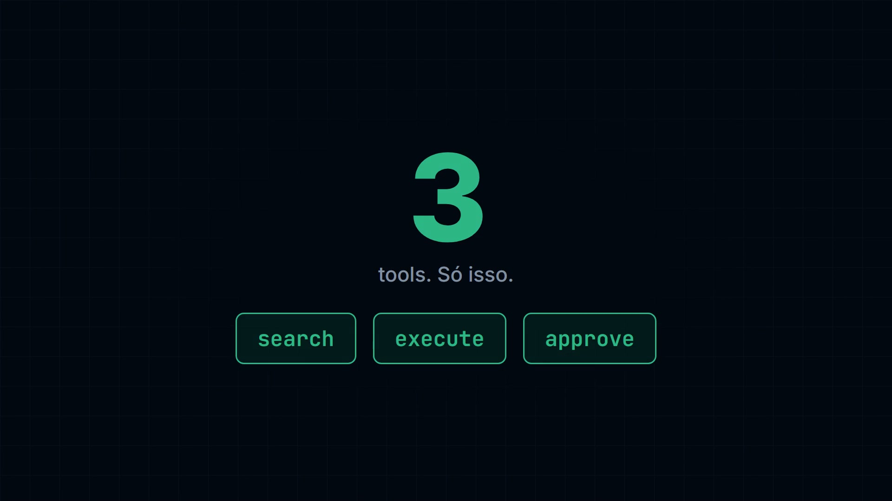
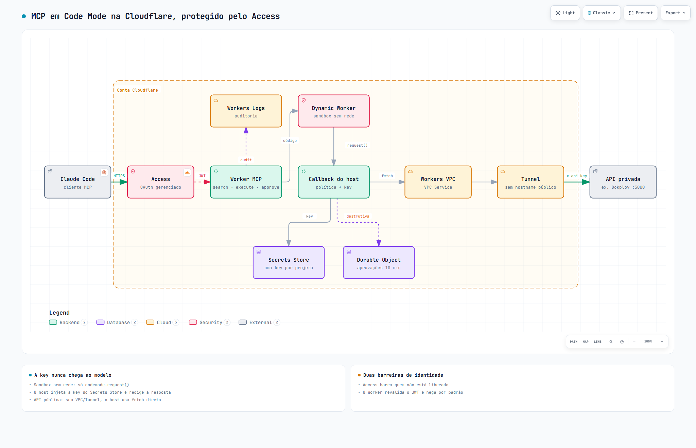

# mcp-codemode-cloudflare

Servidor MCP remoto em **Code Mode** (padrão *search + execute*) rodando num Cloudflare Worker e
protegido pelo **Cloudflare Access**. Serve para qualquer API que tenha OpenAPI. O exemplo do repositório
é o [Dokploy](https://dokploy.com), mantido privado atrás de um Cloudflare Tunnel.

Em vez de uma tool por endpoint (centenas de definições no contexto do agente), o servidor expõe três:

| Tool | O que faz |
|---|---|
| `search` | o modelo escreve código que filtra o OpenAPI e devolve só as operações relevantes |
| `execute` | o modelo escreve código que chama a API por `codemode.request({ project, method, path, query, body })` |
| `approve` | executa um plano destrutivo que o `execute` guardou, uma vez, em até 10 minutos |

O código do modelo roda num **sandbox sem rede**. A única saída é `codemode.request()`, atendida pelo
Worker, que valida a chamada, aplica a política e injeta a key. **A key nunca chega ao modelo.**

[](docs/demo.mp4)

*Vídeo de 22 s ([`docs/demo.mp4`](docs/demo.mp4)).*



Versão interativa do diagrama (tema claro/escuro, exportação): [`docs/arquitetura.html`](docs/arquitetura.html).

## Por que não um MCP comum

| | MCP comum (local, stdio) | Este servidor |
|---|---|---|
| Quem pode usar | quem tem o arquivo de config com a key | só quem passa no **Cloudflare Access** (OAuth, e-mail liberado) e ainda tem o JWT revalidado no Worker |
| Onde fica a key | em texto no `.claude.json` / variável de ambiente da máquina | no **Secrets Store** da Cloudflare; o modelo e a máquina do usuário nunca a veem |
| O que o modelo pode chamar | qualquer endpoint que a key permita | só paths válidos, do projeto certo, dentro do modo `readonly`/`readwrite` |
| Operação destrutiva | executa direto | vira um **plano com `approvalId`**; só roda com `approve`, uma vez |
| Rede do código gerado | — | nenhuma (`globalOutbound: null`) |
| API privada | precisa expor a porta ou estar na mesma rede | alcançada por **Tunnel + Workers VPC**, sem hostname público |
| Contexto do agente | uma definição por endpoint (o Dokploy tem 604) | três tools, ~1,4 mil tokens, fixo |
| Auditoria | nenhuma | uma linha por chamada nos Workers Logs (quem, projeto, operação, classe, status, duração), sem payload |
| Revogar acesso | trocar a key em todas as máquinas | tirar o e-mail da policy do Access |

## Custo: US$ 5 por mês e quanto isso faz

Tudo cabe no plano **Workers Paid (US$ 5/mês)**. O plano é obrigatório porque o sandbox usa Dynamic Workers.

| Recurso | Incluso nos US$ 5 | Uso por chamada do agente |
|---|---|---|
| Dynamic Workers (sandbox) | **1.000 por dia** (~30 mil/mês) | 1 por `search` ou `execute` (o executor usa `load()` sem ID) |
| Requests de Worker | 10 milhões/mês | 1 |
| CPU | 30 milhões de ms/mês | poucos ms (o tempo esperando a API não conta) |
| Durable Objects (aprovações) | 1 milhão de requests/mês | só em operação destrutiva |
| Workers Logs (auditoria) | 20 milhões de eventos/mês | 1 a 51 |
| Access, Tunnel, Workers VPC, Secrets Store | sem custo (Access grátis até 50 usuários; VPC em beta) | — |

**Na prática: cerca de 1.000 chamadas `search`/`execute` por dia, ~30 mil por mês, por US$ 5.** Como cada
`execute` pode fazer até 50 chamadas à API, isso chega a até ~1,5 milhão de chamadas à API por mês. O
gargalo é sempre o Dynamic Worker; requests e CPU sobram.

Acima de 1.000 no dia, cada `search`/`execute` extra custa US$ 0,002 (US$ 1 a cada 500). A Cloudflare não tem
teto de gasto para Workers: crie um alerta em **Manage Account → Notifications → Billing** se quiser garantia.

Preços conferidos em outubro de 2026; confira antes de publicar:
[Workers](https://developers.cloudflare.com/workers/platform/pricing/) ·
[Dynamic Workers](https://developers.cloudflare.com/dynamic-workers/pricing/) ·
[Durable Objects](https://developers.cloudflare.com/durable-objects/platform/pricing/) ·
[Workers VPC](https://developers.cloudflare.com/workers-vpc/) ·
[Zero Trust](https://www.cloudflare.com/plans/zero-trust-services/).

## Passo a passo

### 0. Pré-requisitos

- Conta Cloudflare com **Workers Paid** e um domínio na Cloudflare (para `mcp.seu-dominio.com`).
- Node 20+ e `npx wrangler login`.
- A API alvo, com o OpenAPI em JSON e uma API key por projeto/usuário.

```bash
git clone https://github.com/<voce>/mcp-codemode-cloudflare && cd mcp-codemode-cloudflare
npm install
```

### 1. Descrever a sua API — `src/config/api.ts`

É o único arquivo que muda de uma API para outra:

| Campo | Exemplo (Dokploy) | Para que serve |
|---|---|---|
| `baseUrl` | `http://127.0.0.1/api` | origem das chamadas; API pública: `https://api.exemplo.com/v1` |
| `authHeader` | `x-api-key` | header onde o Worker injeta a key (`Authorization: Bearer …` exige ajuste no `client.ts`) |
| `methods` | `GET`, `POST` | métodos aceitos |
| `pathPattern` / `pathExample` | `/^\/router\.procedure$/` | paths aceitos; recusa host, `..` e query no path |
| `sensitiveFields` | `env`, `password`, `*token*`… | campos da resposta trocados por `[REDACTED]` antes de chegar ao modelo |
| `help` | — | texto que o modelo lê na descrição do `execute` |

`LIMITS` define 50 chamadas por `execute`, 15 s por chamada e 1 MB por resposta.

### 2. OpenAPI e classificação das operações

```bash
# salve o OpenAPI bruto da sua API em spec/raw.json (fora do git), depois:
npm run spec:trim       # gera spec/openapi.json enxuto (sem respostas e erros genéricos)
npm run spec:classify   # gera policy/classification.json: operação → read | write | destructive
```

Revise o `policy/classification.json` no diff. A regra fica em `scripts/classify.mjs`: verbos como
`remove`, `delete`, `stop`, `kill`, `clean`, `rollback` viram `destructive`. **Operação fora da tabela é tratada
como destrutiva** (fail-closed). Os dois scripts foram escritos para o OpenAPI do Dokploy; para outra API,
ajuste os filtros deles.

### 3. Projetos e keys — `src/config/projects.ts` + Secrets Store

Cada alias aponta para uma key diferente, com um modo:

```ts
export const PROJECTS = {
  exemplo: { keyBinding: 'KEY_EXEMPLO', mode: 'readwrite', description: 'Projeto de exemplo' },
  leitura: { keyBinding: 'KEY_LEITURA', mode: 'readonly', description: 'Projeto só de leitura' },
};
```

Crie o store e uma key por projeto. O comando pede o valor sem mostrar na tela:

```bash
npx wrangler secrets-store store create mcp-keys --remote          # anote o ID
npx wrangler secrets-store secret create <STORE_ID> --name api_key_exemplo --scopes workers --remote
```

No `wrangler.jsonc`, uma entrada por projeto em `secrets_store_secrets`, com o mesmo `binding` do
`projects.ts`. Dê a cada key só as permissões que o projeto precisa **na própria API**: o modo do MCP é uma
segunda barreira, não a única.

### 4. Cloudflare Access na frente do Worker

1. Zero Trust → **Access → Applications → Add an application → Self-hosted**.
2. Domínio: `mcp.seu-dominio.com`. Policy: **Allow**, *Emails* = o seu e-mail (ou um grupo).
3. Ligue **Managed OAuth** na aplicação (o Access passa a ser o servidor OAuth do MCP).
4. Copie o **Application Audience (AUD) Tag** e o domínio do time (`seu-time.cloudflareaccess.com`).

No `wrangler.jsonc`, troque `routes`, `ACCESS_TEAM_DOMAIN` e `ACCESS_AUD`. O Worker revalida o JWT do Access
em toda requisição e responde `403` se ele faltar ou for forjado.

### 5. (Só para API privada) Tunnel + Workers VPC

Para uma API que não pode ficar na internet, crie o tunnel em Zero Trust → **Networks → Tunnels → Create a
tunnel (Cloudflared)**, **sem** Public Hostname, e anote o ID e o token. Depois:

```bash
npx wrangler vpc service create minha-api --type http --tunnel-id <TUNNEL_ID> --ipv4 127.0.0.1 --http-port 3000
```

Rode o `cloudflared` no servidor da API com o token do tunnel (unit de exemplo em
[`infra/cloudflared.service`](infra/cloudflared.service); o token vai num arquivo `0600`, nunca no git) e
descomente `vpc_services` no `wrangler.jsonc` com o ID do VPC Service. Sem esse binding, o Worker usa `fetch`
direto, o que serve para API pública.

### 6. Testar e publicar

```bash
npm run typecheck && npm test   # 38 testes: path, roteamento de key, fail-closed, aprovação, key nunca vaza
npm run deploy
curl -i https://mcp.seu-dominio.com/mcp   # sem login: 401 do Access, com o endereço do OAuth
```

### 7. Conectar no Claude Code

```bash
claude mcp add --scope user --transport http minha-api https://mcp.seu-dominio.com/mcp
claude mcp login minha-api      # abre o login do Access no navegador
```

Depois peça, por exemplo: *"use o minha-api e liste os apps do projeto exemplo"*.

## Como funciona uma chamada

1. O Claude Code chama `execute` com um trecho de JavaScript.
2. O Access confere o login; o Worker revalida o JWT.
3. O código roda num Dynamic Worker sem rede. Cada `codemode.request()` volta para o Worker.
4. O Worker valida `project` e `path`, classifica a operação e aplica o modo:
   `readonly` só lê; `readwrite` lê e escreve; `destructive` vira um plano com `approvalId`.
5. A key sai do Secrets Store e vai no header. A resposta tem os campos sensíveis redigidos.
6. Uma linha de auditoria vai para os Workers Logs (filtre por `audit`).

## Estrutura

| Pasta | Conteúdo |
|---|---|
| `src/config/` | `api.ts` (a sua API) e `projects.ts` (aliases, keys, modos) |
| `src/auth/access.ts` | validação do JWT do Access |
| `src/upstream/client.ts` | validação, limites, chamada à API, redação |
| `src/policy/` | classificação, política e aprovações (Durable Object) |
| `src/index.ts` | servidor MCP (`openApiMcpServer` + `approve`) e auditoria |
| `scripts/` | `trim-spec`, `classify` e `smoke` (testa o MCP contra `wrangler dev --remote`) |
| `docs/` | diagrama de arquitetura (feito com archify) |

## Limites conhecidos

- **Code Mode é experimental** e o Workers VPC está em beta; as APIs podem mudar.
- A resposta final do `execute` é cortada em ~6 mil tokens: filtre no código, não no modelo.
- O Worker Loader aceita até 4 Dynamic Workers simultâneos por requisição.
- Status como `done` vêm da API, não garantem que o serviço está no ar.

## Licença

MIT
